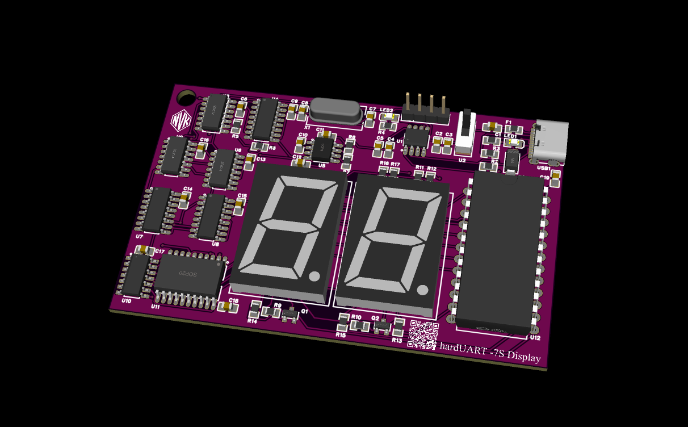

# UART-to-7-Segment Display: Discrete 74HC Logic PCB & SystemVerilog RTL

## Overview

This repository implements a **UART (9600 bps, 8N1) receiver and 2-digit Hexadecimal 7-segment display decoder** across two hardware architectures:

1. **Discrete Hardware Architecture (MCU-Free Custom PCB):** Built using 74HC-series logic ICs, a 2.4576 MHz Pierce crystal oscillator, a CH340N USB-to-UART bridge, and an AT28C16 parallel EEPROM configured as a 512-byte Look-Up Table (LUT).
2. **FPGA RTL Architecture (SystemVerilog):** Synthesizable SystemVerilog modules implementing a 2-FF synchronized UART receiver, a 1-byte buffered UART loopback transmitter, and a multiplexed Common-Anode 7-segment driver on the Digilent Nexys A7-100T board.



---

## Repository Structure

```text
.
├── .github/
│   └── workflows/
│       └── rtl_lint.yml        # Automated Verilator lint check on push
├── constraints/
│   └── Nexys-A7-100T.xdc       # Pinout and 100 MHz clock constraints for Nexys A7-100T
├── docs/                       # Schematics, 3D renders, and simulation captures
├── pcb/                        # EasyEDA source files, Gerber archive, and BOM (59 components)
├── proteus/                    # Proteus simulation project (.pdsprj) and 512-byte ROM binary
├── rtl/
│   ├── top_uart.sv             # Top-level wrapper (RX, TX loopback buffer, LEDs, 7-segment)
│   ├── uart_rx.sv              # 8N1 UART receiver with 2-FF synchronizer and mid-bit sampling
│   ├── uart_tx.sv              # 8N1 UART transmitter for serial echo verification
│   └── seven_seg_hex.sv        # Common-Anode Hex decoder and ~763 Hz digit multiplexer
├── .gitignore                  # Excludes Vivado and Proteus temporary build files
└── README.md
```

---

## System Architecture

### 1. Discrete Logic & EEPROM Hardware (`pcb/` & `proteus/`)

```text
[PC Serial] --(USB-C)--> [PTC 500mA + SMAJ5.0A] --> [CH340N (5V TTL)]
                                                           | (RX_LINE)
                                                           v
[2.4576 MHz XTAL] --> [74HC04 + 74HC161 (/16)] --> [FSM: 74HC74 / 74HC161 / 74HC00]
                            (153.6 kHz)                    | (SAMPLE_CLK & LATCH_CLK)
                                                           v
[NE555 (~533 Hz)] --> [AT28C16 EEPROM (A8)] <---- [74HC164 SIPO] --> [74HC574 Latch]
       |                    | (I/O0..I/O6)
       v                    v
[MMBT3904 x2] ------> [2x 7-Segment LED (CC)]
```

* **USB-C & Power Protection:** 16-pin USB-C connector with dual `5.1 kOhm` CC resistors, `500 mA` PTC fuse (`0805L050WR`), `SMAJ5.0A` TVS diode, and `CH340N` configured at `5.0 V` logic level.
* **Baud Clock & Frame FSM:** `2.4576 MHz` crystal oscillator (`74HC04D`) divided by 16 (`74HC161D`) yields `153.6 kHz` (`16x` oversampling). `74HC74D`, `74HC161D`, and `74HC00D` handle start-bit detection, mid-bit sampling, and stop-bit latching at count 9.
* **EEPROM LUT & Scan:** `AT28C16` (`DIP-24`) stores the 7-segment lookup table. An `NE555D` (`~533 Hz`) toggles address pin `A8` to alternate between the upper nibble (`A8 = 1`, addresses `256..511`) and lower nibble (`A8 = 0`, addresses `0..255`), synchronized with two `MMBT3904` NPN low-side drivers.

### 2. FPGA SystemVerilog RTL (`rtl/` & `constraints/`)

```text
[PC Serial] <--(USB-UART 9600 8N1)--> [FT2232HQ]
                                        |    ^
                               uart_rx  |    |  uart_tx
                                        v    |
                        +-----------------------------------+
                        |             top_uart              |
                        |  +---------+       +-----------+  |
                        |  | uart_rx |--+--->| TX Buffer |  |
                        |  +---------+  |    +-----+-----+  |
                        |               |          v        |
                        |               |    +-----------+  |
                        |               +--->|  uart_tx  |  |
                        |               |    +-----------+  |
                        |               v                   |
                        |         [byte_reg[7:0]]           |
                        |           |         |             |
                        |           v         v             |
                        |      [led[7:0]] [seven_seg_hex]   |
                        |                     |             |
                        |                     v             |
                        |            {ca..cg, dp, an[7:0]}  |
                        +-----------------------------------+
```

| Signal Group | Port Name | FPGA Pin | Description |
| :--- | :--- | :---: | :--- |
| **System** | `clk` | `E3` | `100 MHz` system clock (`CLKS_PER_BIT = 10417`) |
| | `rst` | `N17` | `BTNC` push-button (Active-HIGH reset) |
| **UART** | `uart_rx` | `C4` | Serial input from FT2232HQ USB-UART bridge |
| | `uart_tx` | `D4` | Serial output to FT2232HQ USB-UART bridge |
| **7-Segment** | `ca` .. `cg`, `dp` | `T10, R10, K16, K13, P15, T11, L18, H15` | Active-LOW segment cathodes |
| | `an[1:0]` | `J18, J17` | Active-LOW digit anodes (Upper and lower Hex nibbles) |
| | `an[7:2]` | `U13, K2, T14, P14, J14, T9` | Unused digits tied HIGH to prevent ghosting |
| **Debug LEDs** | `led[7:0]` | `U16` .. `H17` | Parallel 8-bit binary readout of received byte |

---

## Quick Start

1. **Proteus / Discrete PCB:** Open the `.pdsprj` file in `proteus/` with the 512-byte ROM binary loaded into `AT28C16`, or power the `UART-7S Display` PCB via USB-C. Send ASCII `'A'` (`0x41`) at `9600 bps, 8N1` to display **`41`**.
2. **Vivado / Nexys A7-100T:** Add all files in `rtl/` and `constraints/` to a Vivado project (`xc7a100tcsg324-1`), generate the bitstream, and program the board. Sending `'A'` (`0x41`) at `9600 bps, 8N1` displays **`41`** on the rightmost two 7-segment digits, lights `01000001` on `led[7:0]`, and echoes `'A'` back to the terminal.
